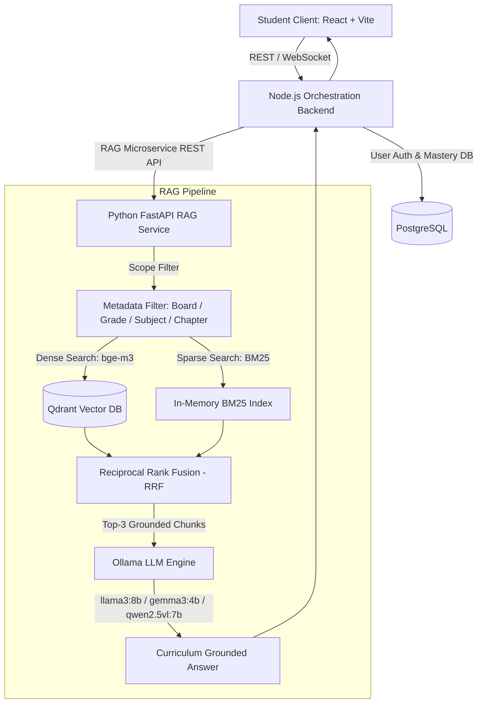

# StudySpace 🎓

> **Curriculum-Grounded Educational AI Tutoring Platform**  
> Powered by Hybrid Retrieval (BM25 + Qdrant Dense Embeddings), Reciprocal Rank Fusion, and Multi-Model Local Generation.

[](https://opensource.org/licenses/MIT)
[](https://www.python.org/downloads/)
[](https://nodejs.org/)
[](https://reactjs.org/)
[](https://fastapi.tiangolo.com/)
[](https://qdrant.tech/)

---

## 📌 Overview

**StudySpace** is an end-to-end intelligent educational tutoring platform designed for school curriculum support (NCERT CBSE Standards 9–12). Unlike general-purpose chatbots that suffer from hallucinations or stray outside grade-level curricula, StudySpace strictly grounds all answers in verified syllabus textbooks, worked solutions, and revision notes.

### Key Capabilities

- **Curriculum-Scoped Retrieval**: Strict metadata filtering on Board (`CBSE`), Grade (`Standard 9`), Subject, and Chapter prevents cross-grade topic drift.
- **Hybrid Retrieval Engine**:
  - **Dense Semantic Retrieval**: 1024-dimensional vectors via `BAAI/bge-m3` indexed in Qdrant using HNSW cosine similarity.
  - **Sparse Lexical Retrieval**: BM25 keyword matching preserving technical formulas, chemical nomenclature, and proper nouns.
  - **Reciprocal Rank Fusion (RRF)**: Merges sparse and dense ranked candidate lists into an optimal top-$k$ context window.
- **Multi-Model Local Generation**:
  - Evaluated across leading open-weight LLMs (`llama3:8b`, `gemma3:4b`, `qwen2.5vl:7b`) hosted locally via Ollama for zero-cloud latency and full privacy.
  - Socratic tutoring guardrails that provide progressive hints rather than giving away final answers.
- **Multimodal Question Ingestion**:
  - Text, photographic OCR (diagram-based physics/math problems), and speech input.
- **Mastery Tracking & Analytics**:
  - PostgreSQL mastery records track student progress, weak topic identification, and spaced repetition flashcards.

---

## 🏗️ Architecture



---

## 📂 Repository Structure

The monorepo is organized into specialized microservices:

```text
StudySpace/
├── AI-Education-Backend/       # Express.js / Node.js Orchestration Backend
│   ├── src/
│   │   ├── api/                # Route definitions & API controllers
│   │   ├── common/             # Shared utilities, middlewares, auth
│   │   ├── config/             # DB & service environment configs
│   │   ├── migrations/         # PostgreSQL database schema migrations
│   │   └── models/             # Sequelize / ORM data models
│   ├── package.json
│   └── server.js
│
├── AI-Education-Frontend/      # Modern React 18 + Vite Web Application
│   ├── src/
│   │   ├── modules/            # Domain modules (Learning, Flashcards, Notes, Chat)
│   │   ├── components/         # Shared UI components & design system
│   │   ├── services/           # Axios HTTP client & socket services
│   │   └── routes/             # App routing & protected route guards
│   ├── tailwind.config.js
│   └── vite.config.js
│
└── RAGProductionApp/           # Python FastAPI Hybrid RAG Microservice
    ├── core/                   # Engine logic, RRF fusion, embeddings
    ├── rag/                    # Chunking, indexing, and retriever pipelines
    ├── config/                 # Service settings, Qdrant client initialization
    ├── models/                 # Pydantic schemas for request/response
    ├── rag_benchmark/          # Benchmarking harness (766 NCERT gold questions)
    ├── pyproject.toml
    └── main.py
```

---

## 📊 Benchmark & Evaluation Results

StudySpace was formally benchmarked across **766 manually-verified NCERT gold questions** spanning 46 chapters in four core CBSE subjects:

| Subject | Chapters | Questions Evaluated | Hybrid Recall@3 | Best Performing Generator | Accuracy |
| :--- | :---: | :---: | :---: | :---: | :---: |
| **Science** | 13 | 215 | **94.0%** | `qwen2.5vl:7b` | **99.1%** |
| **Mathematics** | 8 | 143 | **91.6%** | `qwen2.5vl:7b` | **94.1%** |
| **Social Studies** | 9 | 169 | **98.2%** | `llama3:8b` | **96.8%** |
| **English** | 16 | 239 | **76.6%** | `llama3:8b` | **86.6%** |
| **Overall Suite** | **46** | **766** | **90.1%** | **Multi-Model Consensus** | **94.2%** |

---

## 🚀 Getting Started

### Prerequisites

- **Node.js**: v18.0.0 or higher
- **Python**: v3.11 or higher
- **PostgreSQL**: v14 or higher
- **Qdrant**: Vector Database (Docker container or local instance)
- **Ollama**: Local LLM server (`llama3:8b`, `gemma3:4b`, `qwen2.5vl:7b`)

### 1. Backend Service Setup

```bash
cd AI-Education-Backend
npm install
cp .env.example .env
# Edit .env with your PostgreSQL credentials and JWT secret
npm run migrate
npm run dev
```

### 2. Frontend Application Setup

```bash
cd AI-Education-Frontend
npm install
cp .env.example .env
npm run dev
```

### 3. RAG Microservice Setup

```bash
cd RAGProductionApp
python -m venv .venv
source .venv/bin/activate  # On Windows: .venv\Scripts\activate
pip install -r requirements.txt
cp .env.example .env
# Start FastAPI development server
uvicorn main:app --host 0.0.0.0 --port 8000 --reload
```

---

## 👥 Contributors

- **Harshita Surana** - Project Author & Lead Developer ([GitHub](https://github.com/harshitasurana))

---

## 📄 License

This project is licensed under the MIT License - see the LICENSE file for details.
